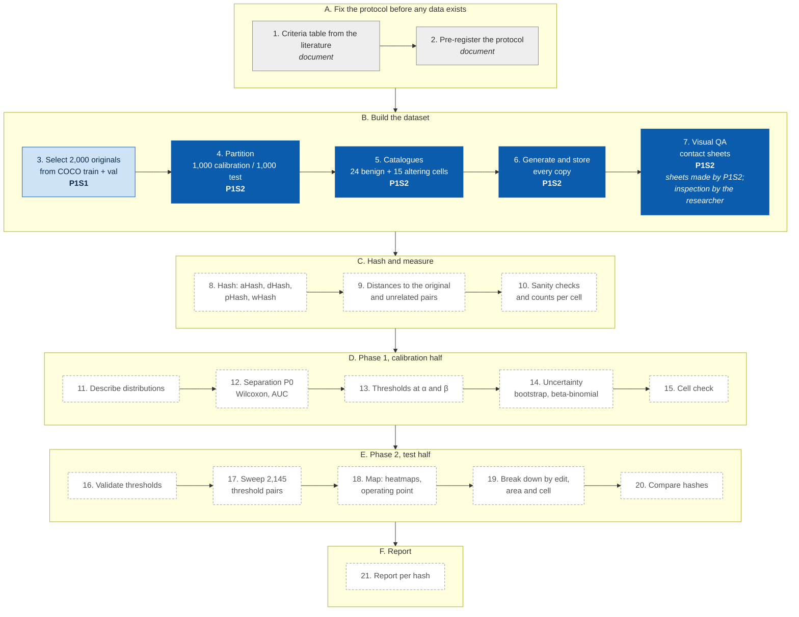

# P1S2 Copy Generator (step 2)

Builds every copy of every original for the Distance-vs-Accuracy experiment (protocol steps 4–7:
partition, catalogues, generation, QA sheets). It reads **only** the output folder of step 1
(`P1S1_COCO_Dataset_Retriever`) and writes the copies to disk.

## Where this script sits in the experiment

The 21 steps of the experiment protocol (final version, approved 29 October 2026). Each script reads only the output of the script before it.

**Dark blue:** this repository (P1S2 · P1S2_Copy_Generator), protocol steps 4, 5, 6, 7. **Light blue:** the other finished script (P1S1 · P1S1_COCO_Dataset_Retriever), step 3. **Grey:** protocol documents, not scripts. **Dashed:** scripts not written yet. Step 7 is partly automated: P1S2 draws the contact sheets and the researcher inspects them.

## Usage

    python3 -m venv .venv && source .venv/bin/activate
    python3 -m pip install -r requirements.txt
    python3 -m unittest discover -s tests -v                                   # self-test, no network
    python3 generate_copies.py --in ~/COCOSubset --out ~/DVA_pilot --limit 100  # pilot
    python3 generate_copies.py --in ~/COCOSubset --out ~/DVA_copies             # full run

Options: `--seed` (master seed, default 20261029, the same as step 1), `--limit N` (first N originals
of the seeded order, for a pilot; their halves match the full run), `--workers` (default: all cores;
the output does not depend on it), `--qa` (contact sheets, default 50), `--no-verify` (skip re-reading
each PNG).

**`--limit` and splice copies.** Because the partition is computed over all originals before `--limit`
is applied, the half each original lands in always matches the full run. Removal and copy-move copies
also match the full run, since they only use the image's own objects. **Splice** copies are the
exception: a splice draws its donor object from the other originals processed in the same half, so
under `--limit N` the donor pool is only those `N` originals and a splice copy need not be byte-for-byte
identical to the one a full run would produce. To reproduce splice copies exactly, use the same
`--limit` (or no `--limit`) that created them.
An interrupted run resumes when started again with the same settings and output folder.

## Input (step-1 output)
`images/*.jpg` (original COCO bytes) and `annotations/instances_<split>2017.json`. Object outlines,
crowd flags and licences are read from the JSON, not from `labels/*.txt`: the YOLO files split an
object with several polygon parts into several lines and carry no crowd flag. For a train+val pool
(step 1 `--split trainval`) both annotation files are read and merged. When step 1 wrote
`images_manifest.csv` (version 1.1), every JPEG is checked against its SHA-256 before use and the run
stops on any mismatch; the checksums of step 1's records are stored in `run_metadata.json`.

## Output
| Path | Content |
| --- | --- |
| `originals/<id>.png` | JPEG decoded once to 8-bit RGB, stored lossless. The reference for every distance |
| `copies/<id>/<cell>.png` | One copy per catalogue cell (24 benign, 15 content-altering) |
| `manifest_originals.csv` | Half, size, licence id, SHA-256 of the JPEG and of the PNG |
| `manifest_copies.csv` | Status (`ok` / `not_applicable` + reason), parameters, target and measured area, changed-pixel share, donor/source object, attempts, seed, SHA-256 |
| `qa/contact_<id>.png` | Original plus all its copies, for the visual check |
| `run_metadata.json` | Settings, full catalogue, every parameter, Python/library/codec versions, SHA-256 of the annotations, the selection log and this script |

## Rules implemented
* **Partition:** seeded shuffle of the sorted image ids, alternating calibration/test (exact 50/50).
* **Seeds:** every copy's random choices use SHA-256(master seed, image id, cell), so results do not
  depend on run order or the number of processes.
* **Splice:** donor object from another original in the same half; donor and copy-move objects cover
  1–20% of their own image; scaled to the target area; Gaussian feather σ = 0.8 px.
* **Copy-move:** object from the same image, scaled to the target area, pasted where it does not overlap itself.
* **Removal:** mask dilated twice (3×3); the 0.6–1.6× target window applies **after** dilation; the
  object closest to the target is erased with OpenCV Telea inpainting (radius 3).
* **Not applicable:** up to 30 placement attempts, then the cell is recorded as not applicable.
* **Sharpening:** unsharp mask, radius 2, 100%, threshold 0.

## Author and license
Author: Jose Luis del Valle (joseluisdelvalle@gmail.com). MIT License; see `LICENSE`.
